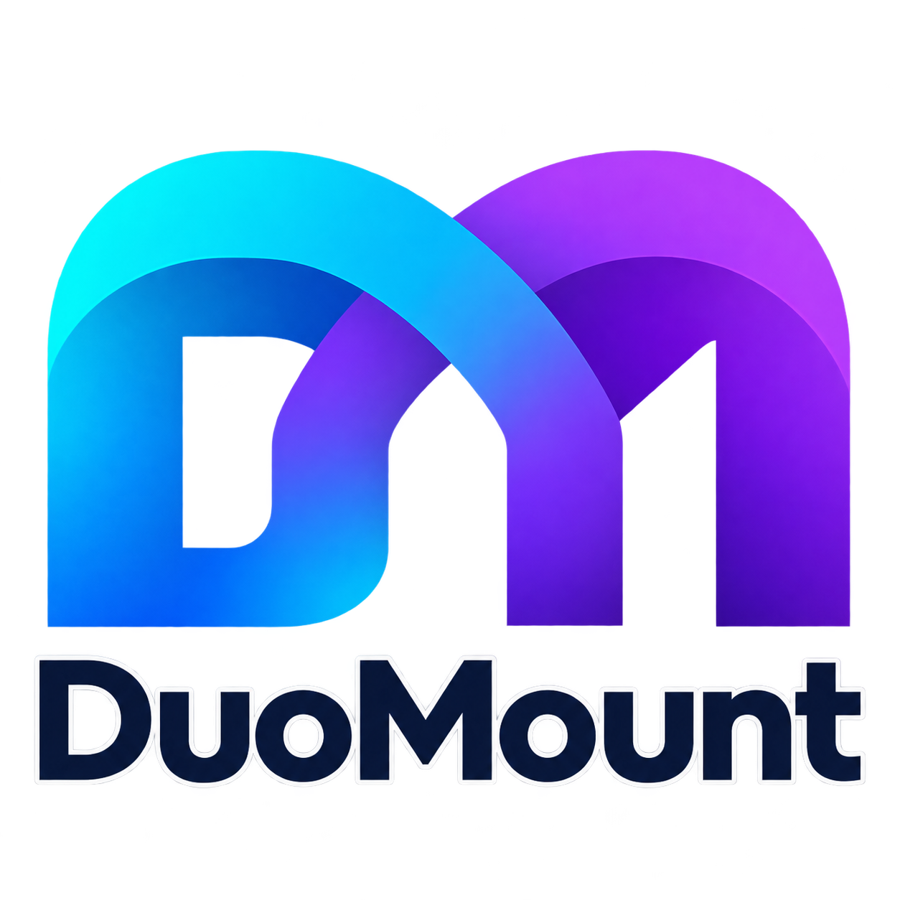

<p align="center"></p>

# DuoMount – experimentelle Beta 1

**Ein PS5-Payload für Ordner, unterstützte Images und direkte PS5-Debug-FPKGs.**
DuoMount verbindet die ShadowMountPlus-Basis von **drakmor** mit der eingebetteten
FPKG-Laufzeit aus Kraken Mount von **quer3q**. Das Projekt hieß im ersten lokalen
Test OneMount. Es ist ein eigener kombinierter Fork, keine offizielle Version
der Originalprojekte. Betreuer: [ysberke](https://github.com/ysberke).

[English README](README.md) · [Downloads](https://github.com/ysberke/DuoMount/releases)

## Was bedeutet Mounten?

Beim **Mounten / Einhängen** wird eine Spieldatei oder ein Image so eingebunden,
dass die Konsole auf seinen Inhalt zugreifen kann – ähnlich einem virtuellen
Laufwerk. **Unmounten / Aushängen** löst diese Verbindung. Die Quelldatei wird
dabei nicht gelöscht. Beende das Spiel, bevor du seine Quelle aushängst.

Ein erkanntes oder gemountetes Spiel muss nicht automatisch fehlerfrei starten:
Dateiformat, Vollständigkeit, Spielversion und Laufzeitkompatibilität spielen
ebenfalls eine Rolle.

## Funktionen

| Bereich | Was DuoMount bereitstellt |
| --- | --- |
| Eine Oberfläche | Gemeinsame Bibliothek und Weboberfläche auf Port 10101; eine ELF statt zweier separater Mounter. |
| Automatische Suche | Einstellbare Suchpfade, Suchtiefe und Intervalle, manuelle Quellen und erneuter Scan. Quellen, die gerade beschrieben werden, werden zunächst zurückgestellt. |
| Spielordner | Übernommene ShadowMountPlus-Unterstützung für geeignete Ordnerquellen. |
| Images | Übernommene UFS-, exFAT-, PFS- und verschachtelte komprimierte Image-Pfade; darunter die unterstützten .ffpkg/.exfat/.ffpfs/.ffpfsc-Workflows. Nicht jede Kombination ist praktisch getestet. |
| PS5-FPKGs | Direkter Zugriff auf vollständige FIH-Debug-PKGs mit PPSA-Kennung. Die große Quelldatei bleibt an ihrem Speicherort; ein gesonderter Cache bereitet Metadaten und Laufzeitdateien vor. |
| Mount-Verwaltung | Ein-/Aushängen, unterstützte Nur-Lesen-/Schreibmodi für Images, Vorbereitung der Spielumgebung und Aufräumen nach Spielende. |
| Bibliotheksdaten | Titel, Cover, Version, Kennungen, Quelle, Registrierung und Aufschlüsselung des Speicherbedarfs. |
| Speicheraktionen | Unterstützte Quellen kopieren/verschieben, Fortschritt und Abbruch von Speicheraufträgen, unterstützte Images entpacken sowie ausdrücklich gewählte Lösch-/Deinstallationsaktionen. |
| USB | Speicherübersicht und sicheres Auswerfen, soweit keine aktive Nutzung entgegensteht. |
| PKG-Verwaltung | Übernommener PKG-Browser, Streaming-/Installationsabläufe und Anzeige installierter Pakete. Direktes FPKG-Mounten ist eine eigene PS5-Funktion. |
| Netzwerk | Weboberfläche, JSON-API und übernommene SMB2/SMB3-Verbindungen für unterstützte Datei-/Speicheraktionen. Das ist keine Zusage, jedes Spiel direkt über SMB starten zu können. |
| Einstellungen | Globale und spielbezogene Profile, Scan-/Mount-Optionen, übernommene Backport-Behandlung sowie passende Fakelib-/Overlay-Einstellungen. |
| Laufzeitmodule | Eingebettetes ampr-emu-ng sowie DLC-/PlayGo-Module. Für FPKGs ist der AMPR-Laufzeitpfad erforderlich; der native Fakelib-Aus-Schalter gilt dafür nicht. |
| Diagnose | Host-/Kernel-Logs, Beobachtung von Spielstarts, Debug-/Ruhemodus und lokalisierte Oberfläche bzw. Meldungen. |
| Erweiterte Optionen | Übernommene Backend-, Sektor-, persistente-Image- und optionale Lüfterziel-Einstellungen, soweit die Host-Unterstützung greift. Für normale Nutzung die Standardwerte verwenden. |

## Mit welchen Komponenten arbeitet es?

- **ShadowMountPlus:** C-Host mit Scanner, Bibliothek, Weboberfläche/API,
  Registrierung, Image-Unterstützung und Speicherverwaltung.
- **Kraken Mount:** Rust-Paketleser, Cache und FPKG-Startüberwachung als statisch
  eingebettete Bibliothek. Ein separater Kraken-Payload wird dafür nicht benötigt.
- **OnionHEN und kstuff-lite:** die kompatible Jailbreak-Umgebung auf der Konsole.
  DuoMount richtet keinen Jailbreak ein und ersetzt diese Voraussetzung nicht.
- **ampr-emu-ng v0.4.1**, **dlc_emu 0.3**, **pgo_stub 0.6:** mitgelieferte
  Homebrew-Laufzeitmodule mit Versions- und Prüfsummendateien. Automatische
  Netzwerkupdates von ng sind in der eingebetteten Brücke ausgeschaltet.
- **PS5 Payload SDK v0.43, LLVM 19 und Rust 1.99.0:** Build-Werkzeuge.
  Die nativen Bibliotheken und deren Versionen stehen in den
  [Komponentenhinweisen](licenses/NATIVE-NOTICES.md).
- **Konsolenspeicher, M.2 und USB:** über die konfigurierten Pfade. Eine Quelle
  auf einem USB-Laufwerk benötigt dieses Laufwerk weiterhin.
- **PC-Browser:** Zugriff auf die Oberfläche bei aktiviertem LAN-Zugriff.
  FileZilla/FTP bleibt ein separates Übertragungswerkzeug; DuoMount stellt
  selbst keinen FTP-Server bereit.

## Starten

1. Kompatiblen Jailbreak sowie die gewohnte OnionHEN-/kstuff-lite-Umgebung aktivieren.
2. Separat laufendes ShadowMountPlus und Kraken Mount beenden.
3. `duomount.elf` mit dem vorhandenen Payload-Loader starten.
4. `http://PS5-IP:10101/` öffnen und ein vollständig übertragenes,
   unterstütztes Spiel testen.

Ein Start pro Konsolensitzung reicht. Bei eingerichtetem Autostart keine zweite
Instanz starten. Ein alter Autostart-Eintrag wird durch Umbenennen einer Datei
nicht automatisch umgestellt.

Die bisherigen Einstellungen unter `/data/shadowmount` und die Cache-Pfade
bleiben kompatibel. Originale Payloads und Konfigurationen vor einem Wechsel
sichern. Die Verwaltungs-API hat keine Anmeldung: LAN-Zugriff ausschließlich im
vertrauenswürdigen Heimnetz verwenden.

## Aktueller Teststand und Grenzen

Der OneMount-Vorgänger wurde auf **einer PS5 mit Firmware 13.60 und OnionHEN**
getestet. Der Anwender meldete **neun erkannte Spiele** und erfolgreiche
Spielstarttests bei allen bisher getesteten Spielen **außer GTA V**. Das ist ein
Anwenderbericht und keine allgemeine Kompatibilitätsgarantie. Der umbenannte
DuoMount-Build benötigt noch einen eigenen Konsolentest.

Technische Mount-/Unmount-Tests bestanden für zwei FPKGs, ein exFAT-Image,
einen FFPFSC-Container und einen Ordner. Die lokalen Build-/Format-/Cache- und
Mount-Prüfungen ersetzen keine längeren Spieltests.

**Bekannter Fehler:** GTA V, PPSA04264, Version 01.011.001, stürzt mit
CE-108255-1 ab. Das Log zeigte SIGBUS / General Protection Fault im RAGE Main
Thread. Die Ursache ist offen; beschädigte Spieldateien sind nicht nachgewiesen.

Weitere Grenzen:

- Unvollständige Übertragungen, Retail-PKGs und LIH-Patches sind keine
  unterstützten direkten FPKG-Quellen.
- Direktes Mounten von FPKGs betrifft unterstützte PS5-Debug-Pakete.
  PS4-Pakete verwenden weiterhin ihren bisherigen Installationsablauf;
  eine zusätzliche PS4Mount-Integration ist nicht Bestandteil dieses Forks.
- Ein FPKG-Cache enthält kein vollständig entpacktes Spiel. Die Image-
  Entpackfunktion darf deshalb nicht als FPKG-Entpacker verstanden werden.
- Titel-, DLC-, Format- und Firmware-Kompatibilität ist nicht flächendeckend getestet.

## Quellcode, Build und Credits

Siehe [Build-Anleitung](BUILD.md), [Integrationsvertrag](fpkg-bridge/DESIGN.md)
und [API-Dokumentation](docs/api.md).

```sh
bash tools/build_native_deps.sh
bash tools/build_duomount.sh
bash tools/check_duomount.sh
python3 tools/check_elf.py
```

Der kombinierte Fork basiert auf den im englischen README genannten, fest
gepinnten Ständen von ShadowMountPlus, Kraken Mount und PS5 Payload SDK.
Die ursprünglichen Copyright-Vermerke, Credits und Lizenztexte bleiben erhalten:
[GPL-Lizenz](LICENSE), [native Komponenten](licenses/NATIVE-NOTICES.md),
[Rust-/Laufzeitkomponenten](fpkg-bridge/THIRD_PARTY_NOTICES).

Das Projektlogo liegt unter `assets/duomount-logo.png`. Die ursprünglichen
Upstream-Grafiken und Credits sind separat erhalten. Spiele, Spielstände,
private Logs und Konsolen-Backups gehören nicht zur Veröffentlichung.
