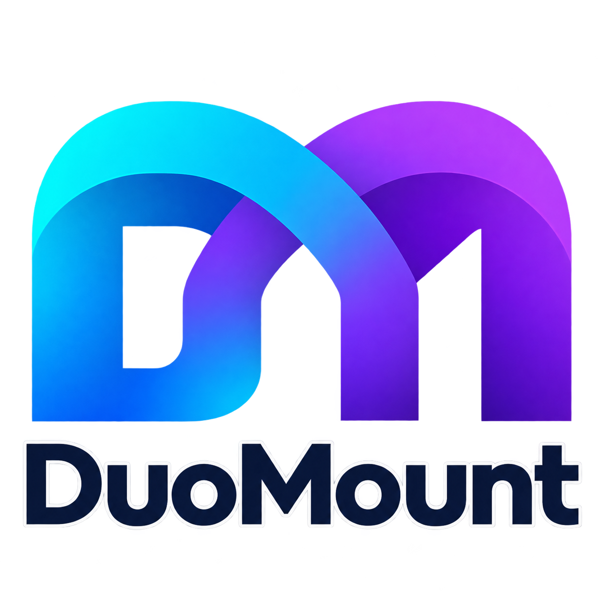

<p align="center"></p>

# DuoMount — experimental beta 1

A combined PS5 homebrew payload based on **ShadowMountPlus** by drakmor and
the embedded FPKG runtime from **Kraken Mount** by quer3q. This integration was
previously named OneMount. It is an independent fork, not an official release
of either upstream project. Maintained by [ysberke](https://github.com/ysberke).

[Deutsche Beschreibung](README.de.md) · [Downloads](https://github.com/ysberke/DuoMount/releases)

## Features

- One ELF with the ShadowMountPlus web interface, scanner and storage controls.
- Existing folder, exFAT, UFS and supported compressed-image handling.
- Direct PS5 debug FPKG support through the embedded Kraken runtime.
- One interface on port 10101 and the existing ShadowMount configuration paths.

## Requirements and use

1. Activate your compatible jailbreak / OnionHEN and kstuff-lite environment.
2. Stop standalone ShadowMountPlus and Kraken Mount before loading this payload.
3. Send `duomount.elf` through your existing payload loader.
4. Open `http://PS5-IP:10101/` and launch a fully transferred supported title.

One start per console session is sufficient. If a payload manager already
starts DuoMount, do not start another copy. Change an old autoload entry
explicitly; renaming the downloaded ELF does not migrate autoload settings.

Existing `/data/shadowmount` configuration and cache paths are retained for
compatibility. Keep your original payloads and configuration backups.
Mounting makes a game source accessible to the console; unmounting releases
that connection without deleting the source file. Stop the game before unmounting.
Use the web interface only on a trusted LAN: its management API has no authentication.

## Test status and known limitations

This is an **experimental beta**, not a general compatibility guarantee.
The predecessor OneMount beta 1 ran on one PS5 with firmware 13.60 / OnionHEN.
The user reported nine detected games and successful launch tests for multiple
titles. This is a single-user report, not a
compatibility guarantee. The renamed build still requires its own console smoke test.

- Mount/unmount checks passed for two FPKGs, an exFAT image, an FFPFSC
  container and a folder in the predecessor build.
- Incomplete transfers, retail packages and LIH patches are not supported
  direct FPKG sources. This direct mount feature is for supported PS5 debug
  packages; PS4 packages continue to use their existing installation workflow.
- An FPKG runtime cache is not a complete unpacked game.
- This project is not intended to diagnose or repair storage hardware faults.

## Building and source provenance

See [build instructions](BUILD.md), the embedded runtime
[design](fpkg-bridge/DESIGN.md), and the [API documentation](docs/api.md).
The build uses PS5 Payload SDK v0.43, LLVM 19 and Rust 1.99.0 with rust-src.

```sh
bash tools/build_native_deps.sh
bash tools/build_duomount.sh
bash tools/check_duomount.sh
python3 tools/check_elf.py
```

Upstream source pins:

- [ShadowMountPlus](https://github.com/drakmor/shadowMountPlus):
  `0b56a1c25e8f07584135fd537ce49736562d6b07`
- [Kraken Mount](https://github.com/quer3q/kraken-mount):
  `e1e784560fe3a56e3b5ffd579f47ed5b2cf194f7`
- [PS5 Payload SDK syscall stub](https://github.com/ps5-payload-dev/sdk):
  `4122b714c7e7a9449d403812b9d640bf7a55af3f`

Original copyright notices, upstream documentation and component licenses are
preserved. See [LICENSE](LICENSE), [native notices](licenses/NATIVE-NOTICES.md)
and [embedded runtime notices](fpkg-bridge/THIRD_PARTY_NOTICES).
The included homebrew runtime binaries retain their upstream version/hash files.
No games, saves, firmware dumps or console backups are included.

When reporting a bug, include the firmware, payload version, source format and
a short relevant log excerpt. Remove private paths, network credentials and
unrelated personal information before posting.

## Capability reference

| Area | Available functionality and scope |
| --- | --- |
| Discovery | Configurable scan roots/depth/interval, source-stability waiting, manual sources, rescan and duplicate-source arbitration. |
| Formats | Game folders and the inherited UFS/exFAT/PFS and nested compressed-image paths; direct PS5 FIH debug FPKGs with PPSA title IDs. Not every title/format combination is validated. |
| Mount lifecycle | Mount/unmount managed sources, read-only/read-write image modes where supported, launch-time sandbox preparation and cleanup. |
| Library | Metadata, icons, title IDs, versions, source paths, registration and storage-size breakdowns. |
| Storage | Space overview, copy/move supported sources, asynchronous progress/cancellation, image unpacking, explicit source deletion/uninstallation and safe USB ejection when possible. |
| PKG workflow | Inherited PKG browser, streaming/install operations and installed-package visibility. Direct FPKG mounting is a separate PS5 feature. |
| Network | Web UI / JSON API on port 10101 and inherited SMB2/SMB3 connections for supported browsing/storage operations. This does not imply every game can execute directly over SMB. |
| Profiles | Global and per-game settings, scan/mount settings, backport handling inherited from the host, fakelib/overlay policies for supported native sources. FPKGs use the mandatory embedded AMPR runtime. |
| Emulators | Bundled ampr-emu-ng, DLC and PlayGo components with version/hash records. Automatic ng network updating is disabled in the embedded bridge. |
| Diagnostics | Host and kernel-log views, game-launch monitoring, debug/quiet settings and localized UI/notifications. |
| Advanced host options | Backend/sector settings, persistent images and optional fan target where inherited host support applies; keep defaults unless you understand the option. |

## What it works with

- **ShadowMountPlus** supplies the C host, scanner, UI/API, registration, image
  handling, storage jobs and native lifecycle hooks.
- **Kraken Mount** supplies the Rust package reader/cache and FPKG launch watcher
  as an embedded static library; no second standalone Kraken server is started.
- **kstuff-lite / OnionHEN** provide the compatible console environment; this
  payload does not install or replace your jailbreak.
- **ampr-emu-ng v0.4.1**, **dlc_emu 0.3** and **pgo_stub 0.6** are bundled homebrew
  components. Native library versions and licenses are listed in
  [NATIVE-NOTICES](licenses/NATIVE-NOTICES.md).
- Local console storage, an M.2 SSD and connected USB sources use the existing
  configured paths. A source left on USB still requires that drive to be connected.
- A PC browser can manage the UI when LAN access is enabled. FTP software such
  as FileZilla remains a separate transfer tool; DuoMount is not an FTP server.

## Branding

Project artwork is available in `assets/duomount-logo.png`. Original upstream
notification artwork and all original credits are retained separately.

[Payload Manager icon setup](docs/PAYLOAD-MANAGER.md)
